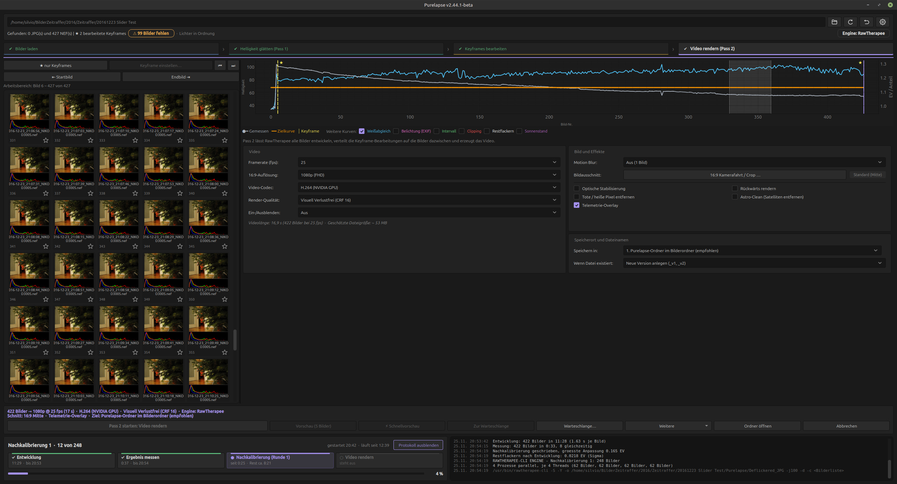

# Purelapse

[Deutsch](README.md) · **English**

**Flicker-free timelapses – from RAW or JPG sequences, with ART, RawTherapee or Darktable.**

> ⚠️ **Beta version.** Purelapse is under active development. Please back up
> your original images and report bugs as an [issue](https://github.com/purelapse/purelapse/issues).



**Before – after:** left untouched, right processed with Purelapse

https://github.com/user-attachments/assets/08c6d79c-24cf-44d8-aacb-35ddfd3aa6f2

## Contents

- [What Purelapse does](#what-purelapse-does)
- [Features at a glance](#features-at-a-glance)
- [Deflicker](#deflicker)
- [Holy grail: day-to-night transitions](#holy-grail-day-to-night-transitions)
- [Keyframes and quick settings](#keyframes-and-quick-settings)
- [Video output and quality](#video-output-and-quality)
- [Image and effects](#image-and-effects)
- [Analysis and warnings](#analysis-and-warnings)
- [Preview and comparison](#preview-and-comparison)
- [Queue and Telegram](#queue-and-telegram)
- [Performance](#performance)
- [User interface](#user-interface)
- [Installation (Linux)](#installation-linux)
- [Running from source](#running-from-source)
- [Building it yourself](#building-it-yourself)
- [Known limitations](#known-limitations)
- [License](#license)

## What Purelapse does

In timelapses with changing light (sunsets, holy grail, night shots) the
brightness jumps from frame to frame. Purelapse smooths this out in three
steps:

1. **Pass 1 – smooth brightness:** Purelapse measures the brightness of every
   RAW in linear light and writes an exposure correction into the engine's
   sidecar files (`.arp`, `.pp3` or `.xmp`).
2. **Keyframes (optional):** Grade individual frames – right inside Purelapse
   with the quick settings, or in the engine. Purelapse blends smoothly in
   between.
3. **Pass 2 – render video:** The engine develops all frames, Purelapse
   re-measures the result, corrects the remaining deviation in further rounds
   and creates the video.

JPG sequences are processed in a single pass, without an external engine.

## Features at a glance

| Area | Features |
|---|---|
| **Deflicker** | Measurement in linear light (16 bit) without blown-out areas, two-stage smoothing, recalibration until residual flicker is below 0.008 EV, measuring area (ROI), light progression sunrise/sunset/constant |
| **Holy grail** | Compensates exposure and ISO jumps, detects ramping intervals, EXIF exposure and sun elevation as curves, remove night in 24-hour timelapses |
| **RAW development** | ART, RawTherapee, Darktable, Lightroom Classic (via XMP); formats NEF, CR2, CR3, DNG, ARW, RAF, ORF, RW2, PEF, SRW |
| **Keyframes** | Smooth blending between keyframes (with Darktable the complete module stack), quick settings with a real engine preview, automatic optimisation, highlight reconstruction |
| **Video** | 720p to 8K, 23.976 to 120 fps, H.264, H.265 (also 10 bit), ProRes 422 HQ, BT.709 colour space, optional 16-bit intermediate images, CPU or NVIDIA, Intel QuickSync, VAAPI, four quality levels |
| **Effects** | Motion blur (3–25 frames), 16:9 camera move, stabilisation, denoise, hot pixels, astro clean, telemetry overlay, fade in/out, reverse |
| **Checks** | Quick preview, 5-frame preview, untouched version, comparison video, warnings for gaps and highlights |
| **Workflow** | Batch queue, Telegram notification, resume after cancelling, parallel processing |
| **Interface** | Step bar, progress display with timings, light and dark theme, German and English |

## Deflicker

- **Measurement in linear light.** RAWs are measured at 16 bit with gamma 1.0.
  This keeps the measurement reliable even in dark night shots, where an 8-bit
  measurement would merge large parts of the image into black.
- **Two-stage smoothing.** The *deflicker strength* slider sets how strongly
  the curve is smoothed: low values only remove fast flicker, high values also
  reshape the light progression. From 85 % on, the curve blends seamlessly
  into a straight regression line.
- **Light progression.** *Constant* keeps the progression as it is; *sunrise*
  and *sunset* enforce a progression that only gets brighter or only gets
  darker.
- **Exposure (EV).** Shifts the target brightness of the whole sequence by up
  to ±3 EV.
- **Blown-out areas don't count.** The sun and lamps stay equally bright no
  matter how the camera exposes, and would distort the measurement. Purelapse
  leaves out pixels that are clipped on the sensor; recalibration only uses
  areas that are not blown out in any frame of the sequence.
- **Measuring area (ROI).** Restricts the measurement to part of the frame –
  useful when moving objects disturb the measurement.
- **Recalibration.** After developing, Purelapse measures the engine's result,
  writes the remaining deviation back into the sidecar files and has them
  developed again – only the frames that actually changed. Up to three rounds;
  stops as soon as the residual flicker is below 0.008 EV.
- **Existing edits are kept.** Purelapse only sets the exposure in the
  profile. With Darktable it writes it into the active exposure instance; your
  own exposure change is kept as an offset, the rest of the history untouched.
- **JPG workflow.** JPG sequences are deflickered directly, without an engine,
  and can optionally be saved as single images without a video.
- **Can be switched off.** Without the *Deflicker* tick the timelapse keeps the
  brightness the camera recorded – keyframes, camera move, telemetry and
  effects still work. For RAW, pass 1 then only prepares the profiles. The
  switch is remembered per folder.

## Holy grail: day-to-night transitions

In holy-grail shots the camera changes shutter speed, aperture or ISO during
the sequence. Purelapse is built for this:

- **Compensating exposure jumps.** Because every RAW is measured in linear
  light, the jumps caused by changed camera settings show up as brightness
  steps – and the deflicker smooths them out.
- **Ramping interval.** If the shooting interval grows or shrinks with the
  shutter speed, Purelapse treats that as normal and only reports real gaps.
- **Curves for checking.** Besides brightness, the chart can show the EXIF
  exposure and the interval.
- **Sun elevation.** With latitude and longitude (or GPS from the image),
  Purelapse shows the sun elevation as a curve and marks the limits of civil,
  nautical and astronomical twilight – ideal for placing keyframes.
- **Remove night.** In 24-hour timelapses, frames below an adjustable scene
  brightness drop out of the video. Image and EXIF exposure are measured
  together, in stops below daylight – so the night is detected even when the
  camera exposed longer at night. The threshold is a line in the chart that
  can be dragged; single outliers (headlights, a cloud) do not chop up the
  night. The whole series is still deflickered so the twilight is right.

## Keyframes and quick settings

- **Keyframes.** Individual frames are marked as keyframes (5 stars) and
  graded in the engine or in Purelapse. When rendering, Purelapse carries the
  settings smoothly across all frames in between.
- **Darktable: the whole module stack.** All modules of Darktable keyframes
  go into the frames in between. Numeric values – white balance, colour
  calibration, sharpening, colour balance rgb, filmic, sigmoid, tone equalizer
  and about 60 more – are blended smoothly, hues along the shorter way round
  the colour wheel. Switches, masks and modules that exist in only one
  keyframe come from the nearer keyframe; Purelapse reports them beforehand.
  Exception: shadows and highlights and colour balance rgb are blended
  smoothly from their zero setting even then.
- **Quick settings** (ART and RawTherapee; for Darktable all except white
  balance and denoising) right inside Purelapse via
  *Edit keyframe…*, without opening the engine:

  | Control | Range |
  |---|---|
  | Colour temperature | 2000 – 12000 K |
  | Green balance | 0.6 – 1.8 |
  | Brightness, contrast, vibrance, saturation | −100 – +100 |
  | Recover highlights, lift shadows | 0 – 100 |
  | Sharpening | 1 – 1000 |
  | Denoise luminance / chrominance | 0 – 100 |

  Every control has its own checkbox: anything left unticked stays unchanged
  in the profile. Exposure is excluded – that belongs to the deflicker.
  Highlights and shadows work locally (ART: tone equalizer, RawTherapee:
  shadows/highlights, Darktable: shadows and highlights); Purelapse scales
  the values per engine so the same slider does roughly the same everywhere.
- **Real preview.** The engine develops the frame with the chosen values,
  with a histogram and *show before*.
- **Automatic optimisation.** Measures the frame and makes it pleasing:
  pulls the highlights down, lifts the shadows, gives the midtones punch and
  the colours vibrance; plus sharpening and denoising matched to the ISO
  value. Night scenes stay dark. Each value with the reason it is based on.
- **Copy from another keyframe.** Transfer the settings of one keyframe to
  another.
- **Highlight reconstruction.** Against the pink sun disc: recovers clipped
  colour channels from their surroundings (ART: Blend, Color, Balanced;
  RawTherapee: Blend, Color, Coloropp).
- **Keyframes only.** Filters the filmstrip down to the marked frames.

## Video output and quality

| Setting | Options |
|---|---|
| **Resolution (16:9)** | 720p (HD Ready), 1080p (Full HD), 1440p (2.5K), 2160p (4K), 4320p (8K) |
| **Frame rate** | 23.976 · 24 · 25 · 29.97 · 30 · 50 · 59.94 · 60 · 120 fps |
| **Quality** | Visually lossless (CRF 16) · High (CRF 20) · Standard (CRF 23) · Low (CRF 28) |
| **Fade in / out** | Off · 0.5 · 1 · 2 · 3 seconds from/to black |
| **Location** | `Purelapse` folder inside the image folder (default), parent folder, program folder or a folder of your choice |
| **Existing file** | Create a new version (`_v1`, `_v2`, …) or overwrite |

**Video codecs:**

| Codec | Encoding | File |
|---|---|---|
| H.264 | CPU (libx264) | `.mp4` |
| H.264 | NVIDIA GPU (NVENC) | `.mp4` |
| H.264 | Intel QuickSync | `.mp4` |
| H.264 | VAAPI (AMD/Intel) | `.mp4` |
| H.265 / HEVC | CPU (libx265) | `.mp4` |
| H.265 / HEVC | NVIDIA GPU (NVENC) | `.mp4` |
| H.265 / HEVC | Intel QuickSync | `.mp4` |
| H.265 / HEVC | VAAPI (AMD/Intel) | `.mp4` |
| H.265 / HEVC 10 bit | CPU (libx265) | `.mp4` |
| H.265 / HEVC 10 bit | NVIDIA GPU (NVENC) | `.mp4` |
| Apple ProRes 422 HQ | CPU | `.mov` |

- **Codec self-test.** Before every run Purelapse checks whether the chosen
  hardware codec works on this computer and otherwise offers the matching CPU
  codec.
- **Estimated file size** is shown before you start.
- **BT.709 colour space**, tagged in the video – colours as in the frames.
- **16-bit intermediate images (TIFF)** on request: the engine develops to
  16 bit and the video is computed in 16 bit throughout – no banding in sky
  gradients, especially with HEVC 10 bit or ProRes. Needs many times the disk
  space; Purelapse checks beforehand that there is enough.

## Image and effects

- **Motion blur.** Averages 3, 4, 5, 6, 7, 8, 9, 10, 12, 15, 18, 20 or 25
  frames into one video frame – for soft, cinematic movement of clouds, water
  and stars.
- **16:9 camera move / crop.** Set the framing for the first and the last
  frame; in between the camera moves smoothly from A to B – with sub-pixel
  precision (no judder) and a gentle start and stop. Without it, the frame is
  cropped to 16:9 around the centre.
- **Optical stabilisation.** Evens out shake between frames (costs a little
  of the frame edge).
- **Denoise.** Noise reduction, stronger at high ISO values.
- **Remove dead / hot pixels.** For RAW via the engine (Darktable: "hot
  pixels" module); for JPG, Purelapse
  looks for points that stand out at the same position throughout the
  sequence – stars and subject details stay untouched.
- **Astro clean.** Removes satellite trails by comparing every frame with its
  two neighbours.
- **Telemetry overlay.** Shows time, ISO, aperture and shutter speed in the
  video.
- **Render in reverse.** Plays the sequence backwards.
- **Start and end frame.** Limits the whole workflow to part of the sequence;
  saved per folder.

## Analysis and warnings

- **Brightness chart** with measured curve, target curve, keyframes and the
  selected frame; optional curves: white balance, exposure (EXIF), interval,
  clipping, residual flicker and sun elevation.
- **Gaps in the sequence.** Missing frames are detected from the capture times
  and shown with their position.
- **Clipped highlights.** Share of pixels that are at the sensor's limit, per
  frame.
- **Pink highlights.** Warns about the typical magenta sun disc and points to
  highlight reconstruction.
- **Fluctuating white balance** of the camera within the sequence is reported.
- **Diagnostic mode.** Optionally writes measurement logs (CSV) and check
  reports to the image folder.

## Preview and comparison

- **⚡ Quick preview.** A rough video in minutes instead of hours, built from
  the camera's embedded preview images, with the smoothing from the chart and
  the chosen framing (up to 1280 pixels wide).
- **Preview (5 frames).** Develops five frames spread across the sequence with
  all settings – saves a whole wasted run.
- **Untouched version.** The timelapse without any processing, as a reference.
- **Comparison video.** Places two finished videos side by side or as a split
  screen.

## Queue and Telegram

- **Queue.** Add several folders, each with its own settings, and have them
  processed one after another. Cancelling pauses the batch; the next start
  resumes at the same point.
- **Telegram notification.** When a run finishes or fails, Purelapse sends a
  message with the folder, the steps, their duration and the residual flicker.
  Purelapse finds the chat ID itself; a test message checks the connection.

## Performance

- **Parallel development.** Several engine processes with a few cores each
  instead of one process with all cores – much faster on many-core machines.
  *Automatic* adapts to the number of cores and the free memory.
- **darktable-cli in parallel**, up to four processes, each with its own
  configuration folder – also works while darktable is open.
- **Parallel measurement** on several cores; the video phase reads frames
  ahead in several threads.
- **Resume after cancelling.** Frames that were already developed and have not
  changed are not developed again.

## User interface

- **Step bar** guides you through load images → smooth brightness → edit
  keyframes → render video; completed steps are marked.
- **Start dialog** offers to continue the last workflow.
- **Progress display** with progress, remaining time and the duration of every
  step.
- **Log** with timestamps; opens by itself when an error occurs.
- **Reset** deletes selected working files in the image folder.
- **Engine detection.** If sidecar files already exist in the folder,
  Purelapse selects the matching engine itself.
- **Light and dark theme**, interface in **German and English**.

## Installation (Linux)

1. Install **RawTherapee**, **ART** and/or **darktable** (for RAW development).
2. Download `Purelapse-…-x86_64.AppImage` from
   [Releases](https://github.com/purelapse/purelapse/releases).
3. Make it executable and start it:
   ```bash
   chmod +x Purelapse-*-x86_64.AppImage
   ./Purelapse-*-x86_64.AppImage
   ```
4. In Purelapse, open **Settings** (gear icon, top right) and enter the path
   to `rawtherapee-cli`, `ART-cli` or `darktable-cli`.

**Engines as Flatpak (Flathub):** Purelapse finds RawTherapee, ART and
darktable from Flathub by itself; the settings then show e.g.
`flatpak:com.rawtherapee.RawTherapee`. Purelapse starts the command-line
program inside the package with `flatpak run --command=…` and grants the
engine exactly the folders it needs for the run (images, output, work folder).

**darktable:** supports 4.6 to 5.6. XMPs from darktable 5 (exposure
version 7, white balance version 4) are read and written in their own version;
keyframes from darktable 4 and 5 can be blended together.

**Lightroom Classic (Windows, macOS):** Lightroom has no command line –
Purelapse writes the XMP files, Lightroom develops. Workflow:

1. In Lightroom select all frames of the sequence → *Metadata → Save
   Metadata to File* (Ctrl+S). Mark keyframes with 5 stars.
2. In Purelapse choose the engine "Lightroom (XMP)" and run pass 1.
3. Run pass 2: Purelapse blends the keyframes into the XMP files.
4. In Lightroom *Read Metadata from Files*, then export as JPG (quality 100)
   or 16-bit TIFF with the original file name to `Purelapse/Lightroom_Export`.
5. Run pass 2 once more: Purelapse fine-adjusts the residual flicker of the
   export and builds the video.

Only Lightroom Classic writes XMP files; DNG files are not supported
(Lightroom stores their settings inside the DNG). Purelapse can edit the XMP
files on Linux too, e.g. when the folder is on a server.

The AppImage contains Python, Qt, OpenCV, rawpy and FFmpeg. It runs on
Linux Mint 21 / Ubuntu 22.04 and newer. If a system FFmpeg is installed, it is
preferred (matching the graphics driver).

JPG sequences don't need an engine.

## Windows (in preparation)

Purelapse is being prepared for Windows. A test build as a single `.exe` can
be made under *Actions → Windows-Paket*; it has not yet been tried on a real
Windows machine with the engines.

- Purelapse finds the engines in the search path and in the usual install
  folders (`C:\Program Files\ART`, `…\RawTherapee\<version>`,
  `…\darktable\bin`); otherwise enter them under **Settings**.
- Settings and base profiles live in `%LOCALAPPDATA%\Purelapse`.
- File names containing a colon (such as `2016-12-26_20:15:32.nef`) are not
  allowed on Windows – rename such sequences first.
- Hardware encoders: NVIDIA and Intel QuickSync; VAAPI exists only on Linux.

## Running from source

```bash
git clone https://github.com/purelapse/purelapse.git
cd purelapse
python3 -m venv .venv
.venv/bin/pip install -r requirements.txt
.venv/bin/python purelapse_main.py
```

## Building it yourself

Build the AppImage with `bash build_appimage.sh` (requires Docker and internet).

## Known limitations

- Darktable: white balance and denoise in the quick settings are only
  available for ART and RawTherapee – darktable stores camera-dependent values
  there.

## Tests

About 3000 automated checks run through the whole program – with real
measurement, real FFmpeg and finished videos. They run on every push to GitHub
and can be started locally:

```bash
pip install numpy scipy opencv-python-headless
python tests/alle.py
```

## Settings

Purelapse writes exactly one configuration file:
`~/.config/purelapse/purelapse.json`. Settings from older versions
(`~/.purelapse_*`) are taken over on first start and removed.

In the image folder, only the engine's sidecar files (`.arp`, `.pp3`,
`.xmp`) sit next to the images. Everything else – videos, developed frames
(`Deflickered_JPG`), measurement data and logs – goes into the subfolder
`Purelapse`.

## License

Purelapse is licensed under the [GNU General Public License v3](LICENSE).

Purelapse calls ART, RawTherapee, Darktable and FFmpeg as separate programs;
their own licenses apply to them. The AppImage contains an FFmpeg build from
the `imageio-ffmpeg` package.

Copyright (C) 2026 slvobng
