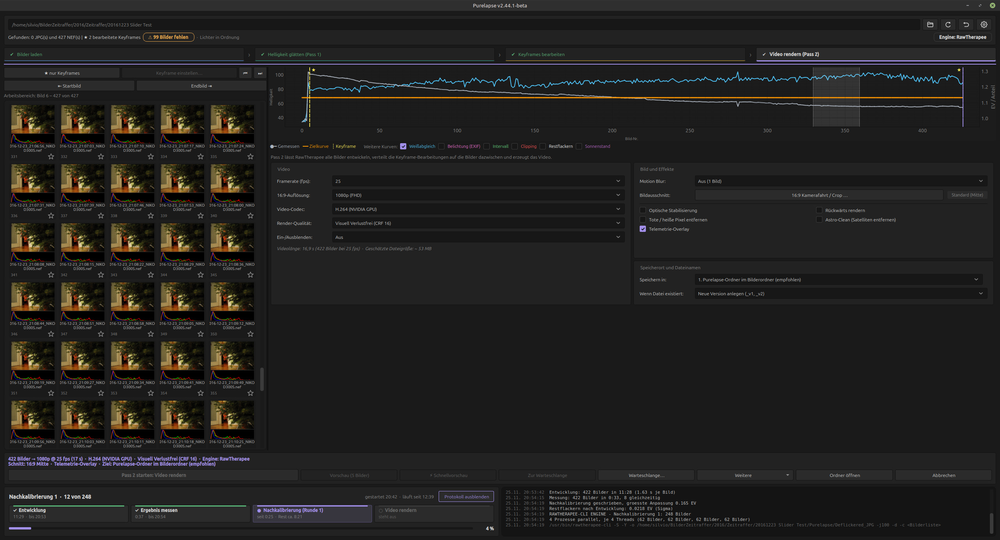

# Purelapse

**Deutsch** · [English](README.en.md)

**Zeitraffer ohne Flackern – aus RAW- oder JPG-Serien, mit ART, RawTherapee, Darktable, RapidRAW oder Lightroom Classic. Für Linux und Windows.**

> ⚠️ **Beta-Version.** Purelapse wird aktiv entwickelt. Bitte Originalbilder
> sichern und Fehler als [Issue](https://github.com/purelapse/purelapse/issues) melden.



**Vorher – nachher:** links unbearbeitet, rechts mit Purelapse

https://github.com/user-attachments/assets/08c6d79c-24cf-44d8-aacb-35ddfd3aa6f2

## Inhalt

- [Was Purelapse macht](#was-purelapse-macht)
- [Funktionen im Überblick](#funktionen-im-überblick)
- [Deflicker](#deflicker)
- [Holy Grail: Tag-Nacht-Übergänge](#holy-grail-tag-nacht-übergänge)
- [Keyframes und Schnelleinstellungen](#keyframes-und-schnelleinstellungen)
- [Video-Ausgabe und Qualität](#video-ausgabe-und-qualität)
- [Bild und Effekte](#bild-und-effekte)
- [Analyse und Warnungen](#analyse-und-warnungen)
- [Vorschau und Vergleich](#vorschau-und-vergleich)
- [Warteschlange und Telegram](#warteschlange-und-telegram)
- [Leistung](#leistung)
- [Bedienung](#bedienung)
- [Installation (Linux)](#installation-linux)
- [Installation (Windows)](#installation-windows)
- [Aus dem Quelltext starten](#aus-dem-quelltext-starten)
- [Selbst bauen](#selbst-bauen)
- [Bekannte Einschränkungen](#bekannte-einschränkungen)
- [Lizenz](#lizenz)

## Was Purelapse macht

Bei Zeitraffern mit wechselndem Licht (Sonnenuntergang, Holy Grail,
Nachtaufnahmen) springt die Helligkeit von Bild zu Bild. Purelapse glättet
diesen Verlauf in drei Schritten:

1. **Pass 1 – Helligkeit glätten:** Purelapse misst die Helligkeit jedes RAWs
   in linearem Licht und schreibt eine Belichtungskorrektur in die
   Begleitdateien der Engine (`.arp`, `.pp3`, `.xmp` oder `.rrdata`).
2. **Keyframes (freiwillig):** Einzelne Bilder gestalten – direkt in Purelapse
   über die Schnelleinstellungen oder in der Engine. Purelapse blendet
   dazwischen weich über.
3. **Pass 2 – Video rendern:** Die Engine entwickelt alle Bilder, Purelapse
   misst das Ergebnis nach, korrigiert die Abweichungen in weiteren Runden und
   erzeugt das Video.

JPG-Serien laufen in einem einzigen Durchgang, ohne externe Engine.

## Funktionen im Überblick

| Bereich | Funktionen |
|---|---|
| **Deflicker** | Messung in linearem Licht (16 Bit) ohne ausgebrannte Flächen, zweistufige Glättung, Nachkalibrierung bis unter 0,008 EV Restflackern, Messbereich (ROI), Lichtverlauf Sonnenaufgang/-untergang/gleichbleibend |
| **Holy Grail** | Belichtungs- und ISO-Sprünge werden ausgeglichen, wechselndes Intervall wird erkannt, EXIF-Belichtung und Sonnenstand als Kurven, Nacht entfernen bei 24-Stunden-Zeitraffern |
| **RAW-Entwicklung** | ART, RawTherapee, Darktable, RapidRAW, Lightroom Classic (über XMP); Formate NEF, CR2, CR3, DNG, ARW, RAF, ORF, RW2, PEF, SRW |
| **Keyframes** | Weiche Überblendung zwischen Keyframes (bei Darktable der komplette Modulstapel, bei RapidRAW alle Regler), Schnelleinstellungen mit echter Engine-Vorschau, Bildleiste im Look der Engine, automatisch optimieren, Lichter-Rekonstruktion |
| **Video** | 720p bis 8K, 23,976 bis 120 fps, H.264, H.265 (auch 10 Bit), ProRes 422 HQ, Farbraum BT.709, optional 16-Bit-Zwischenbilder, CPU oder NVIDIA, Intel QuickSync, VAAPI, vier Qualitätsstufen |
| **Effekte** | Motion Blur (3–25 Bilder), 16:9-Kamerafahrt, Stabilisierung, Entrauschen, Hotpixel, Astro-Clean, Telemetrie-Overlay, Ein-/Ausblenden, rückwärts |
| **Kontrolle** | Schnellvorschau, 5-Bilder-Vorschau, Rohfassung, Vergleichsvideo, Lücken- und Lichter-Warnungen |
| **Ablauf** | Warteschlange, Telegram-Benachrichtigung, Fortsetzen nach Abbruch, parallele Verarbeitung |
| **Oberfläche** | Schrittleiste, Ablaufanzeige mit Zeiten, helles und dunkles Design, Deutsch und Englisch |

## Deflicker

- **Messung in linearem Licht.** RAWs werden mit 16 Bit und Gamma 1,0 gemessen.
  So bleibt die Messung auch in dunklen Nachtaufnahmen zuverlässig, wo eine
  8-Bit-Messung große Bildteile als Schwarz zusammenfassen würde.
- **Zweistufige Glättung.** Der Regler *Deflicker-Stärke* bestimmt, wie stark
  geglättet wird: niedrig entfernt nur schnelles Flackern, hoch formt auch den
  Lichtverlauf. Ab 85 % geht die Kurve stufenlos in eine reine
  Ausgleichsgerade über.
- **Lichtverlauf.** *Gleichbleibend* lässt den Verlauf, wie er ist;
  *Sonnenaufgang* und *Sonnenuntergang* erzwingen einen Verlauf, der nur heller
  bzw. nur dunkler wird.
- **Belichtung (EV).** Verschiebt die Zielhelligkeit der ganzen Sequenz um bis
  zu ±3 EV.
- **Ausgebranntes zählt nicht mit.** Sonne und Lampen bleiben gleich hell,
  egal wie die Kamera belichtet, und würden die Messung verfälschen. Purelapse
  lässt Bildpunkte weg, die auf dem Sensor ausgebrannt sind; die
  Nachkalibrierung nimmt nur Bereiche, die in keinem Bild der Sequenz
  ausbrennen.
- **Messbereich (ROI).** Beschränkt die Messung auf einen Bildausschnitt –
  sinnvoll, wenn bewegte Objekte die Messung stören.
- **Nachkalibrierung.** Nach dem Entwickeln misst Purelapse das Ergebnis der
  Engine, schreibt die verbleibende Abweichung in die Begleitdateien zurück und
  lässt neu entwickeln – nur die Bilder, die sich geändert haben. Bis zu drei
  Runden; Abbruch, sobald das Restflackern unter 0,008 EV liegt.
- **Bestehende Bearbeitungen bleiben erhalten.** Purelapse setzt nur die
  Belichtung im Profil. Bei Darktable schreibt es sie in die wirksame
  Belichtungsinstanz; die eigene Belichtungsänderung bleibt als Abstand
  erhalten, der übrige Verlauf unangetastet.
- **JPG-Workflow.** JPG-Serien werden direkt und ohne Engine entflackert, auf
  Wunsch auch nur als Einzelbilder ohne Video.
- **Abschaltbar.** Ohne den Haken *Entflackern* entsteht der Zeitraffer mit der
  Helligkeit, die die Kamera aufgenommen hat – Keyframes, Kamerafahrt,
  Telemetrie und Effekte wirken trotzdem. Bei RAW bereitet Pass 1 dann nur die
  Profile vor. Der Schalter wird je Ordner gemerkt.

## Holy Grail: Tag-Nacht-Übergänge

Bei Holy-Grail-Aufnahmen verändert die Kamera während der Serie Belichtungszeit,
Blende oder ISO. Purelapse ist dafür ausgelegt:

- **Belichtungssprünge ausgleichen.** Weil jedes RAW in linearem Licht gemessen
  wird, erscheinen die Sprünge durch geänderte Kameraeinstellungen als
  Helligkeitsstufen – und werden vom Deflicker geglättet.
- **Wechselndes Intervall.** Wächst oder schrumpft das Aufnahmeintervall mit der
  Belichtungszeit, erkennt Purelapse das als normal und meldet nur echte Lücken.
- **Kurven zur Kontrolle.** Neben der Helligkeit lassen sich die
  EXIF-Belichtung und das Intervall im Diagramm einblenden.
- **Sonnenstand.** Mit Breiten- und Längengrad (oder GPS aus dem Bild) zeigt
  Purelapse den Sonnenstand als Kurve und markiert die Grenzen der
  bürgerlichen, nautischen und astronomischen Dämmerung – ideal, um dort
  Keyframes zu setzen.
- **Nacht entfernen.** Bei 24-Stunden-Zeitraffern fallen Bilder unterhalb einer
  einstellbaren Szenenhelligkeit aus dem Video. Gemessen wird Bild und
  Belichtung aus den EXIF-Daten zusammen, in Blenden unter dem Tageslicht –
  die Nacht wird also auch erkannt, wenn die Kamera nachts länger belichtet hat.
  Die Grenze steht als Linie im Diagramm und lässt sich dort verschieben;
  einzelne Ausreißer (Scheinwerfer, Wolke) zerstückeln die Nacht nicht.
  Entflackert wird weiter die ganze Serie, damit die Dämmerung stimmt.

## Keyframes und Schnelleinstellungen

- **Keyframes.** Einzelne Bilder werden als Keyframe markiert (5 Sterne) und in
  der Engine oder in Purelapse gestaltet. Beim Rendern überträgt Purelapse die
  Einstellungen weich auf alle Bilder dazwischen.
- **Darktable: ganzer Modulstapel.** Aus Darktable-Keyframes gehen alle Module
  in die Bilder dazwischen. Zahlenwerte – Weißabgleich, Farbkalibrierung,
  Schärfe, Farbbalance RGB, Filmic, Sigmoid, Tonwert-Equalizer und rund 60
  weitere – werden weich überblendet, Farbtöne auf dem kürzeren Weg um den
  Farbkreis. Schalter, Masken und Module, die nur in einem Keyframe vorkommen,
  kommen vom näheren Keyframe; Purelapse meldet sie vorher. Ausnahme:
  „Schatten und Lichter“ und Farbbalance RGB werden auch dann weich von
  ihrer Nullstellung aus überblendet.
- **RapidRAW: alle Regler.** Aus RapidRAW-Keyframes gehen alle Zahlenregler
  weich in die Bilder dazwischen, auch verschachtelte (HSL, Color Grading,
  Kalibrierung) und Kurven mit gleich vielen Punkten. Masken, KI-Retusche,
  Zuschnitt, Drehung, LUT und Tone Mapper kommen vom näheren Keyframe.
- **Bildleiste im Look der Engine.** Keyframes zeigen schon vor Pass 2 das
  Bild, das die Engine aus ihnen macht (RapidRAW, ART, RawTherapee,
  darktable) – im Hintergrund entwickelt, verkleinert abgelegt und erst nach
  einer Änderung neu gerechnet. Nach Pass 2 zeigt die Bildleiste die
  entwickelten Bilder, bei Lightroom den Export.
- **Schnelleinstellungen** (ART und RawTherapee; bei Darktable alle außer
  Weißabgleich und Entrauschen; bei RapidRAW Kontrast, Lichter, Tiefen,
  Dynamik, Sättigung und Entrauschen) direkt in Purelapse über
  *Keyframe einstellen…*, ohne die Engine zu öffnen:

  | Regler | Bereich |
  |---|---|
  | Farbtemperatur | 2000 – 12000 K |
  | Grünabgleich | 0,6 – 1,8 |
  | Helligkeit, Kontrast, Dynamik, Sättigung | −100 – +100 |
  | Lichter abdunkeln, Tiefen aufhellen | 0 – 100 |
  | Schärfe | 1 – 1000 |
  | Entrauschen Helligkeit / Farbe | 0 – 100 |

  Jeder Regler hat ein eigenes Häkchen: Was nicht angehakt ist, bleibt im
  Profil unverändert. Die Belichtung bleibt ausgenommen – die gehört dem
  Deflicker. Lichter und Tiefen wirken lokal (ART: Tonwert-Equalizer,
  RawTherapee: Schatten/Lichter, Darktable: Schatten und Lichter); Purelapse
  rechnet die Werte je Engine so um, dass derselbe Regler überall ungefähr
  dasselbe bewirkt.
- **Echte Vorschau.** Die Engine entwickelt das Bild mit den gewählten Werten,
  mit Histogramm und *Vorher zeigen*. Solange sie rechnet, steht eine
  weichgezeichnete Näherung da, und der Hinweis pulsiert.
- **Automatisch optimieren.** Misst das Bild und macht es gefällig: holt die
  Lichter herunter, hellt die Tiefen auf, gibt dem Mittelton Biss und den
  Farben Dynamik; dazu Schärfe und Entrauschen passend zum ISO-Wert. Nachtszenen
  bleiben dunkel. Jeder Wert mit Begründung, worauf er beruht.
- **Von anderem Keyframe übernehmen.** Einstellungen eines Keyframes auf einen
  anderen kopieren.
- **Lichter-Rekonstruktion.** Gegen den rosa Sonnenball: rechnet ausgebrannte
  Farbkanäle aus der Umgebung nach (ART: Blend, Farbe, Ausgewogen;
  RawTherapee: Blend, Farbe, Farbfortsetzung).
- **Nur Keyframes zeigen.** Filtert die Bildleiste auf die markierten Bilder.

## Video-Ausgabe und Qualität

| Einstellung | Möglichkeiten |
|---|---|
| **Auflösung (16:9)** | 720p (HD Ready), 1080p (Full HD), 1440p (2,5K), 2160p (4K), 4320p (8K) |
| **Bildrate** | 23,976 · 24 · 25 · 29,97 · 30 · 50 · 59,94 · 60 · 120 fps |
| **Qualität** | Visuell verlustfrei (CRF 16) · Hoch (CRF 20) · Standard (CRF 23) · Niedrig (CRF 28) |
| **Ein-/Ausblenden** | Aus · 0,5 · 1 · 2 · 3 Sekunden aus/nach Schwarz |
| **Speicherort** | Ordner `Purelapse` im Bilderordner (Standard), übergeordneter Ordner, Programmordner oder eigener Ordner |
| **Vorhandene Datei** | Neue Version anlegen (`_v1`, `_v2`, …) oder überschreiben |
| **Dateiname** | `Ordner_Purelapse_2160p_25fps_RT.mp4` – bei RAW mit dem Kürzel der Engine: `AR` ART, `RT` RawTherapee, `DT` darktable, `RR` RapidRAW, `LR` Lightroom |

**Video-Codecs:**

| Codec | Kodierung | Datei |
|---|---|---|
| H.264 | CPU (libx264) | `.mp4` |
| H.264 | NVIDIA GPU (NVENC) | `.mp4` |
| H.264 | Intel QuickSync | `.mp4` |
| H.264 | VAAPI (AMD/Intel) | `.mp4` |
| H.265 / HEVC | CPU (libx265) | `.mp4` |
| H.265 / HEVC | NVIDIA GPU (NVENC) | `.mp4` |
| H.265 / HEVC | Intel QuickSync | `.mp4` |
| H.265 / HEVC | VAAPI (AMD/Intel) | `.mp4` |
| H.265 / HEVC 10 Bit | CPU (libx265) | `.mp4` |
| H.265 / HEVC 10 Bit | NVIDIA GPU (NVENC) | `.mp4` |
| Apple ProRes 422 HQ | CPU | `.mov` |

- **Codec-Selbsttest.** Vor jedem Lauf prüft Purelapse, ob der gewählte
  Hardware-Codec auf dem Rechner funktioniert, und bietet sonst den passenden
  CPU-Codec an.
- **Geschätzte Dateigröße** wird schon vor dem Start angezeigt.
- **Farbraum BT.709**, im Video gekennzeichnet – Farben wie im Bild.
- **16-Bit-Zwischenbilder (TIFF)** auf Wunsch: Die Engine entwickelt nach
  16 Bit, das Video wird durchgehend in 16 Bit gerechnet – keine Stufen in
  Himmelsverläufen, vor allem mit HEVC 10 Bit oder ProRes. Braucht ein
  Vielfaches an Platz; Purelapse prüft vorher, ob er reicht. Der Schalter
  sitzt im Bereich „Video“ und ist in der Regel nicht nötig; solange er an
  ist, steht er dort in Warnfarbe samt Platzbedarf.

## Bild und Effekte

- **Motion Blur.** Mittelt 3, 4, 5, 6, 7, 8, 9, 10, 12, 15, 18, 20 oder 25
  Bilder zu einem Videobild – für weiche, filmische Bewegung von Wolken,
  Wasser und Sternen.
- **16:9-Kamerafahrt / Crop.** Bildausschnitt für das erste und das letzte
  Bild festlegen; dazwischen fährt die Kamera weich von A nach B – mit
  Bruchteilen von Bildpunkten (kein Ruckeln) und sanftem An- und Abfahren.
  Ohne Angabe wird mittig auf 16:9 zugeschnitten.
- **Optische Stabilisierung.** Gleicht Verwacklungen zwischen den Bildern aus
  (kostet etwas Bildrand).
- **Entrauschen.** Rauschminderung, stärker bei hohen ISO-Werten.
- **Tote / heiße Pixel entfernen.** Bei RAW über die Engine (Darktable: Modul
  „Hotpixel“); bei JPG sucht
  Purelapse Punkte, die in der ganzen Sequenz an derselben Stelle auffallen –
  Sterne und Motivdetails bleiben unangetastet.
- **Astro-Clean.** Entfernt Satellitenspuren durch Vergleich jedes Bildes mit
  seinen beiden Nachbarn.
- **Telemetrie-Overlay.** Blendet Uhrzeit, ISO, Blende und Belichtungszeit ins
  Video ein.
- **Rückwärts rendern.** Spielt die Sequenz rückwärts ab.
- **Start- und Endbild.** Begrenzt den ganzen Arbeitsgang auf einen Teil der
  Serie; wird je Ordner gespeichert.

## Analyse und Warnungen

- **Helligkeitsdiagramm** mit gemessener Kurve, Zielkurve, Keyframes und
  gewähltem Bild; zuschaltbar: Weißabgleich, Belichtung (EXIF), Intervall,
  Clipping, Restflackern und Sonnenstand.
- **Lücken in der Sequenz.** Fehlende Aufnahmen werden aus den Aufnahmezeiten
  erkannt und mit Position angezeigt.
- **Ausgebrannte Lichter.** Anteil der Bildpunkte, die auf dem Sensor am
  Anschlag stehen, je Bild.
- **Rosa verfärbte Lichter.** Warnung vor dem typischen magentafarbenen
  Sonnenball, mit Hinweis auf die Lichter-Rekonstruktion.
- **Schwankender Weißabgleich** der Kamera innerhalb der Serie wird gemeldet.
- **Diagnose-Modus.** Schreibt auf Wunsch Messprotokolle (CSV) und
  Prüfberichte in den Bilderordner.

## Vorschau und Vergleich

- **⚡ Schnellvorschau.** Ein grobes Video in Minuten statt Stunden, aus den
  eingebetteten Vorschaubildern der Kamera, mit der Glättung aus dem Diagramm
  und dem gewählten Bildausschnitt (bis 1280 Pixel breit).
- **Vorschau (5 Bilder).** Entwickelt fünf über die Sequenz verteilte Bilder
  mit allen Einstellungen – spart einen kompletten Fehldurchlauf.
- **Rohfassung.** Der Zeitraffer ganz ohne Bearbeitung, als Referenz.
- **Vergleichsvideo.** Stellt zwei fertige Videos nebeneinander oder als
  geteiltes Bild gegenüber.

## Warteschlange und Telegram

- **Warteschlange.** Mehrere Ordner mit jeweils eigenen Einstellungen
  einreihen und nacheinander abarbeiten lassen. Abbrechen hält den Stapel an;
  beim nächsten Start geht es an derselben Stelle weiter.
- **Telegram-Benachrichtigung.** Nach Abschluss oder bei einem Fehler schickt
  Purelapse eine Nachricht mit Ordner, Arbeitsschritten, Dauer und
  Restflackern. Die Chat-ID ermittelt Purelapse selbst; eine Testnachricht
  prüft die Verbindung.

## Leistung

- **Parallele Entwicklung.** Mehrere Engine-Prozesse mit je wenigen Kernen
  statt eines Prozesses mit allen Kernen – auf vielkernigen Rechnern deutlich
  schneller. *Automatisch* richtet sich nach Kernzahl und freiem
  Arbeitsspeicher.
- **darktable-cli parallel**, bis zu vier Prozesse, jeder mit eigenem
  Konfigurationsordner – läuft auch bei geöffnetem darktable.
- **Parallele Messung** auf mehreren Kernen; die Videophase lädt die Bilder in
  mehreren Threads voraus.
- **Fortsetzen nach Abbruch.** Bereits entwickelte, unveränderte Bilder werden
  nicht noch einmal entwickelt.

## Bedienung

- **Schrittleiste** führt durch Bilder laden → Helligkeit glätten → Keyframes
  bearbeiten → Video rendern; erledigte Schritte sind markiert.
- **Startdialog** bietet an, den letzten Arbeitsgang fortzusetzen.
- **Ablaufanzeige** mit Fortschritt, Restzeit und Dauer jedes Schritts.
- **Protokoll** mit Zeitstempeln; öffnet sich bei Fehlern von selbst.
- **Zurücksetzen** löscht gezielt Arbeitsdateien im Bilderordner.
- **Engine-Erkennung.** Liegen schon Begleitdateien im Ordner, stellt
  Purelapse die passende Engine selbst ein.
- **Helles und dunkles Design**, Oberfläche auf **Deutsch und Englisch**.

## Installation (Linux)

1. **RawTherapee**, **ART**, **darktable** und/oder **RapidRAW** installieren
   (für die RAW-Entwicklung).
2. Unter [Releases](https://github.com/purelapse/purelapse/releases) die Datei `Purelapse-…-x86_64.AppImage`
   herunterladen.
3. Ausführbar machen und starten:
   ```bash
   chmod +x Purelapse-*-x86_64.AppImage
   ./Purelapse-*-x86_64.AppImage
   ```
4. In Purelapse unter **Einstellungen** (Zahnrad oben rechts) den Pfad zu
   `rawtherapee-cli`, `ART-cli`, `darktable-cli` bzw. `RapidRAW` eintragen.

**Engines als Flatpak (Flathub):** RawTherapee, ART, darktable und RapidRAW aus Flathub
findet Purelapse selbst; in den Einstellungen steht dann z. B.
`flatpak:com.rawtherapee.RawTherapee`. Purelapse startet die
Kommandozeilenfassung im Paket mit `flatpak run --command=…` und gibt der
Engine dabei genau die Ordner frei, die sie für den Lauf braucht (Bilder,
Ausgabe, Arbeitsordner).

**darktable:** unterstützt 4.6 bis 5.6. XMPs aus darktable 5 (Belichtung
Version 7, Weißabgleich Version 4) liest und schreibt Purelapse in ihrer
Version; Keyframes aus darktable 4 und 5 lassen sich gemischt überblenden.

**RapidRAW (ab 1.6):** Purelapse arbeitet mit RapidRAWs Begleitdateien
(`BILD.NEF.rrdata`) und entwickelt mit `RapidRAW export`, ohne dass sich
RapidRAW öffnet. Ablauf:

1. Den Ordner in RapidRAW öffnen, die Keyframes bearbeiten und mit 5 Sternen
   markieren. Mindestens ein Bild der Serie muss in RapidRAW bearbeitet
   sein – daraus kommt der Look für alle anderen.
2. In Purelapse als Engine „RapidRAW“ wählen, Pass 1 starten.
3. Pass 2 starten: Purelapse überblendet die Keyframes, RapidRAW entwickelt
   die ganze Serie in einem Aufruf, Purelapse kalibriert nach und baut das
   Video.

RapidRAWs Belichtungsregler ist keine Blende: er hellt um 2^(Wert / 0,8)
auf. Purelapse rechnet das um. RapidRAW gibt es auch für Windows.

**Lightroom Classic (Windows, macOS):** Lightroom hat keine Kommandozeile –
Purelapse schreibt die XMP-Dateien, Lightroom entwickelt. Ablauf:

1. In Lightroom alle Bilder der Serie auswählen → *Metadaten → Metadaten in
   Datei speichern* (Strg+S). Keyframes mit 5 Sternen markieren.
2. In Purelapse als Engine „Lightroom (XMP)“ wählen, Pass 1 starten.
3. Pass 2 starten: Purelapse überblendet die Keyframes in die XMP-Dateien.
4. In Lightroom *Metadaten aus Dateien lesen*, dann als JPG (Qualität 100)
   oder TIFF 16 Bit mit dem Originalnamen nach `Purelapse/Lightroom_Export`
   exportieren.
5. Pass 2 noch einmal starten: Purelapse gleicht das Restflackern des
   Exports fein aus und baut das Video.

Nur Lightroom Classic schreibt XMP-Dateien; DNG-Dateien werden nicht
unterstützt (Lightroom speichert deren Einstellungen in der DNG selbst). Die
XMP-Dateien kann Purelapse auch unter Linux bearbeiten, etwa wenn der Ordner
auf einem Server liegt.

Die AppImage enthält Python, Qt, OpenCV, rawpy und FFmpeg. Sie läuft auf
Linux Mint 21 / Ubuntu 22.04 und neuer. Ist ein System-FFmpeg vorhanden,
wird dieses bevorzugt (passend zum Grafiktreiber).

Für JPG-Serien wird keine Engine benötigt.

## Installation (Windows)

1. Unter [Releases](https://github.com/purelapse/purelapse/releases) die Datei
   `Purelapse-…-windows-x64.exe` herunterladen (Windows 10/11, 64 Bit). Sie
   enthält Python, Qt, OpenCV, rawpy und FFmpeg; eine Installation ist nicht
   nötig.
2. Starten. Meldet Windows „Der Computer wurde durch Windows geschützt“: Die
   Datei ist nicht signiert – *Weitere Informationen → Trotzdem ausführen*.
3. Für RAW eine Engine installieren (ART, RawTherapee, darktable, RapidRAW) oder mit
   Lightroom Classic über die XMP-Dateien arbeiten (siehe oben).

- Die Engines findet Purelapse im Suchpfad und in den üblichen
  Installationsordnern (`C:\Program Files\ART`, `…\RawTherapee\<Version>`,
  `…\darktable\bin`, `%LOCALAPPDATA%\RapidRAW`), sonst unter
  **Einstellungen** eintragen.
- Einstellungen liegen in `%APPDATA%\Purelapse\purelapse.json`, selbst
  erzeugte Basisprofile unter `%LOCALAPPDATA%\Purelapse`.
- Dateinamen mit Doppelpunkt (etwa `2016-12-26_20:15:32.nef`) sind unter
  Windows nicht erlaubt – solche Serien vorher umbenennen.
- Hardware-Encoder: NVIDIA und Intel QuickSync; VAAPI gibt es nur unter Linux.

## Aus dem Quelltext starten

```bash
git clone https://github.com/purelapse/purelapse.git
cd purelapse
python3 -m venv .venv
.venv/bin/pip install -r requirements.txt
.venv/bin/python purelapse_main.py
```

## Selbst bauen

Die AppImage baust du mit `bash build_appimage.sh` (benötigt Docker und Internet).

## Bekannte Einschränkungen

- Darktable: Weißabgleich und Entrauschen gibt es in den Schnelleinstellungen
  nur für ART und RawTherapee – Darktable speichert dort kameraabhängige Werte.

## Prüfungen

Über 4000 automatische Prüfungen durchlaufen das ganze Programm – mit echter
Messung, echtem FFmpeg und fertigen Videos. Sie laufen bei jedem Push auf
GitHub und lassen sich lokal starten:

```bash
pip install numpy scipy opencv-python-headless
python tests/alle.py
```

## Einstellungen

Purelapse legt genau eine Konfigurationsdatei an:
`~/.config/purelapse/purelapse.json`. Einstellungen älterer Versionen
(`~/.purelapse_*`) werden beim ersten Start übernommen und entfernt.

Im Bilderordner liegen neben den Bildern nur die Begleitdateien der Engine
(`.arp`, `.pp3`, `.xmp`, `.rrdata`). Alles andere – Videos, entwickelte Bilder
(`Deflickered_JPG`), Messwerte und Protokolle – legt Purelapse im
Unterordner `Purelapse` ab.

## Lizenz

Purelapse steht unter der [GNU General Public License v3](LICENSE).

Purelapse ruft ART, RawTherapee, Darktable, RapidRAW und FFmpeg als eigenständige
Programme auf; deren Lizenzen gelten für diese Programme. Die AppImage
enthält ein FFmpeg aus dem Paket `imageio-ffmpeg`.

Lightroom ist eine Marke von Adobe Inc. in den USA und/oder anderen Ländern.
Purelapse ist ein unabhängiges Projekt und steht in keiner Verbindung zu Adobe.

Copyright (C) 2026 slvobng
